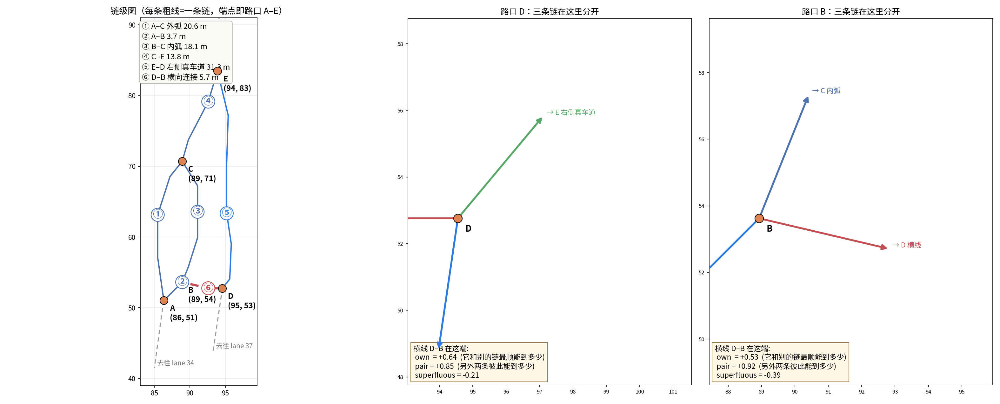
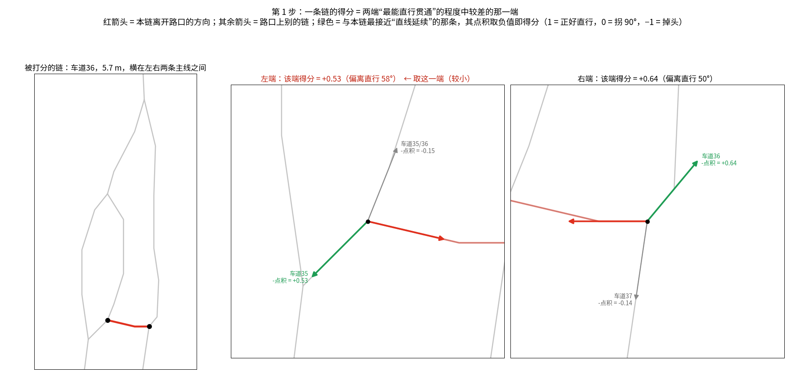
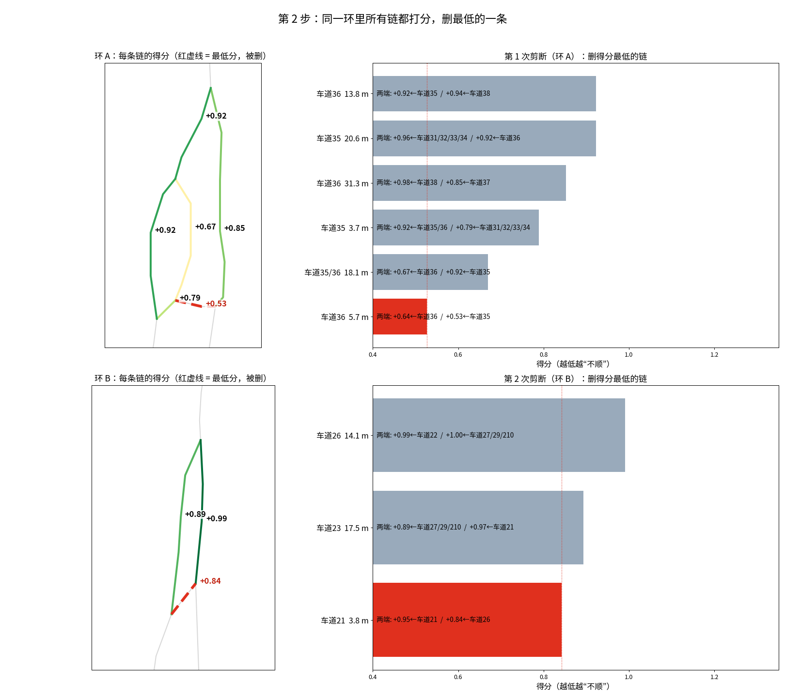
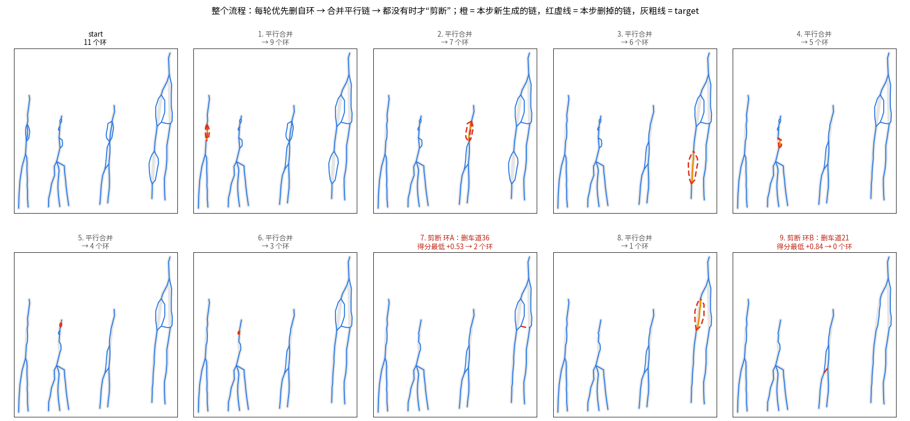
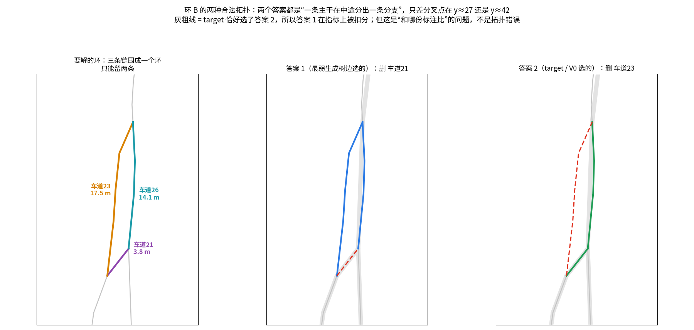
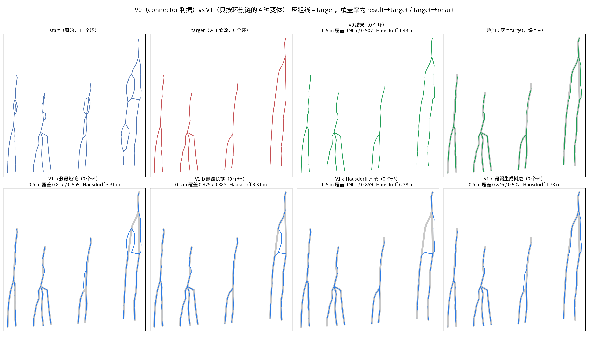

# 算法说明

处理对象是车道中心线组成的无向图。目标：消掉“小环”，保留悬挂端点和真正的大环（环岛等）。

## 共用流程

所有内核都按这个流程运行（[pipeline.py](../src/lane_trans/pipeline.py)），每轮只做**一处**改动，最便宜的规则优先：

```
读入 → 顶点图 → 吸附悬挂端点 → 链图
循环：
    消解度为 2 的节点（把两条链接成一条）
    1. 自环链                → 删
    2. 两端相同的平行链      → 按弧长重采样后逐点取平均
    3. 小环里选一条链        → 删        ← 内核在这里不同
    没有小环了 → 结束
链图 → 写出 output.fgb
```

**顶点图**：1 mm 内的顶点算同一个节点，相邻顶点连成边。

**吸附悬挂端点**（[graph.py](../src/lane_trans/graph.py)）：悬挂端点距另一条线段 ≤ 5 cm 时，把它投影并入那条线段，
并在投影点把线段切开。车道裁剪得刚好差一点没接上时，会把一个小环伪装成钩子；吸附之后它才被看成环。

**链**：两个度 ≠ 2 的节点（路口或悬挂端点）之间的折线。后面的规则都在链上操作。

**小环**：链图的一个双连通分量，含至少 3 条链，且总长 ≤ `max_loop_len`（默认 200 m）。更大的不动。

**平行链取平均**：长度不超过最短链 `parallel_ratio`（默认 1.5）倍的链一起取平均；更长的被视为另一条路线，丢弃。

每一轮都会删一条链或把一束链换成一条，所以循环必然终止。

## v0：连接线判据 + Hausdorff 兜底

[kernels/v0.py](../src/lane_trans/kernels/v0.py)。对每个小环里的每条链算“多余度”：

在路口，两条链“互相贯通”指它们离开路口的方向相反（方向向量点积 ≈ −1）。对链的每一端，比较
- `own`：该链与路口上别的链贯通得最好的程度；
- `pair`：路口上**另外两条**链彼此贯通得最好的程度；

多余度 = `own − pair`。为负，说明没有这条链路口也已经贯通了。

1. **connector**：一条链在**两端**的多余度都低于 `−connector_margin`（默认 −0.10），判为横插连接线，删。多条候选时删最多余的。
2. **redundant**：没有连接线时，删“备选路径与它最像”的链，也就是同一个环里走另一边的最短路径与它的 Hausdorff 距离最小的那条。



上图是 `start.fgb` 里 x≈90 处的环：链 ⑥（D–B，5.7 m 的横向连接）在 D、B 两端的多余度分别是 −0.21 和 −0.39，被判为连接线。
这张图是手工画的，没有生成脚本。

**`connector_margin` 的敏感性**（`scripts/compare_v0_v1_detail.py` 的扫描，对 `start.fgb`）：

| `connector_margin` | 结果 |
|---|---|
| 0.05 – 0.20 | 与默认值相同：0.905 / 0.907，Hausdorff 1.43 m |
| 0 – 0.02 | 第二刀改删车道 21：0.876 / 0.902，1.78 m |
| ≥ 0.25 | 连接线判不出来，退到 Hausdorff 兜底，删了三条：0.901 / 0.859，6.28 m |

默认值 0.10 落在 0.05–0.20 这段稳定区间里，但样本只有一个路段。

## v1：只看环本身的判据

[kernels/v1.py](../src/lane_trans/kernels/v1.py)。没有连接线判据，每个小环只按一个标准剪一条链，四种变体：

| 变体 | 删哪条 |
|---|---|
| `shortest` | 最短的 |
| `longest` | 最长的 |
| `hausdorff` | 备选路径与它 Hausdorff 距离最小的 |
| `weakest_tree`（即 `v1`） | “连续度”最低的 |

**连续度**：对一条链的每一端，取它与路口上别的链“直行贯通”得最好的程度（−点积；1 = 正好直行，0 = 拐 90°，−1 = 掉头），
两端中取较差的一端。最低的链最不像主干上的一段，先删。

`start.fgb` 上 `weakest_tree` 剪了两刀：车道 36（5.7 m 横线）和车道 21（3.8 m）。逐步讲解见下面四张图，
由 `scripts/explain_weakest_tree.py` 生成。






第 4 张图说明：x≈55 处的环有两个同样合法的剪法，只差分叉点的位置。`weakest_tree` 删车道 21，v0 删车道 23，
target 恰好选了后者，所以前者在覆盖率指标上被扣分。这是“与哪份标注比较”的问题，不是拓扑错误。

## v0 与 v1 的对比



两个有分歧的环（A：连接线环；B：车道 21/23/26）的放大对比见 [v0_vs_v1_detail.png](figures/v0_vs_v1_detail.png)。
逐步动画：[loop_steps.gif](figures/loop_steps.gif)（v0，9 步），总览 [loop_steps_overview.png](figures/loop_steps_overview.png)。
